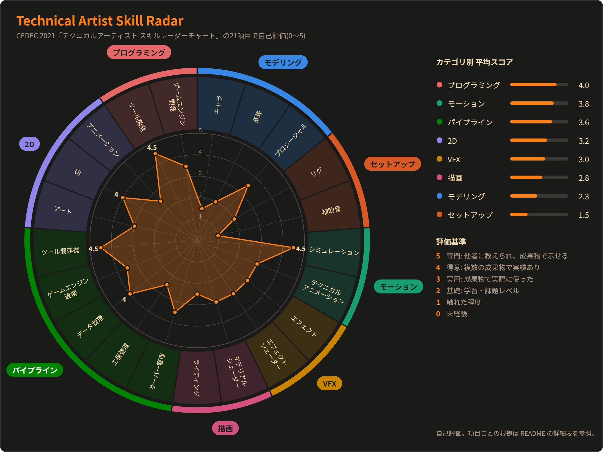

# 松浦真聖 / manato1201

動くものを作りながら、低レイヤーへ潜る。
流体・レンダリング・RAG・開発支援ツールを、一人で設計して実装しています。

  
  

## 主要制作物

### 卒業研究
| 制作物 | ひとこと |
|---|---|
| [DevelopmentRAGEnvironment](https://github.com/manato1201/DevelopmentRAGEnvironment) | RAG を用いた**動的チュートリアル生成**(Houdini) |

### アプリ・Web
| 制作物 | ひとこと |
|---|---|
| [LoreDesktopAndWebSystem](https://github.com/manato1201/LoreDesktopAndWebSystem) ・ [demo](https://lore-desktop-and-web-system.vercel.app) | Lore の GUI(Web + Qt)と Rust 製 API |
| [The-Algorithm-Illustrated](https://github.com/manato1201/The-Algorithm-Illustrated) ・ [demo](https://the-algorithm-illustrated.vercel.app) | アルゴリズムの図鑑 |
| [ColorEncyclopedia](https://github.com/manato1201/ColorEncyclopedia) ・ [demo](https://color-encyclopedia.vercel.app) | 色彩検定対策を兼ねた色・図形の図鑑 |
| [FoundationsEncyclopedia](https://github.com/manato1201/FoundationsEncyclopedia) ・ [demo](https://foundations-encyclopedia.vercel.app) | 言語・IT・AI の基礎の図鑑 |
| [WeatherGeoBridge](https://github.com/manato1201/WeatherGeoBridge) ・ [demo](https://weathergeobridge.vercel.app) | 天気と地図のダッシュボード(Vercel + Cloudflare Workers) |
| [miyagisite](https://github.com/manato1201/miyagisite) ・ [demo](https://miyagisite.vercel.app) | Next.js で作った Web サイト |

### 補助ツール
| 制作物 | ひとこと |
|---|---|
| [Research-Collector](https://manato1201.github.io/Research-Collector/) | 研究情報の自動収集(NotebookLM 連携) |
| [CADGPUInferenceModeling](https://manato1201.github.io/CADGPUInferenceModeling/) | CAD から 3D を推論(TripoSR) |
| [AssetDataInsightSuite](https://github.com/manato1201/AssetDataInsightSuite) | アセット品質の取込・検出・可視化 |
| [VisualRegressionQATool](https://github.com/manato1201/VisualRegressionQATool) | スクリーンショット差分による QA |
| [ToolOrchestrationHub](https://github.com/manato1201/ToolOrchestrationHub) | ツール群の死活監視とアラートの集約 |
| [FlowchartVisualizerExtension](https://github.com/manato1201/FlowchartVisualizerExtension) | 制御フローを可視化する IDE 拡張(VSCode / Visual Studio / Rider) |
| [MagicCircleGenerator](https://github.com/manato1201/MagicCircleGenerator) | 魔法陣を動的に生成(TypeScript) |
| [DocsPipeline](https://github.com/manato1201/DocsPipeline) | docstring から API 文書を作り Confluence へ(Sphinx) |
| [ProductionTracker](https://github.com/manato1201/ProductionTracker) | 制作進行ボード(Django + React) |

### 学習成果物
| 制作物 | ひとこと |
|---|---|
| [LearningFluidEngine](https://github.com/manato1201/LearningFluidEngine) | 流体エンジン(SPH / FLIP / GNN / WASM) |
| [LearningQuickDraw](https://github.com/manato1201/LearningQuickDraw) | ミニレンダラー(C++ / SDL2)と DCC 連携 |
| [RAGReel](https://github.com/manato1201/RAGReel)(旧 LearningQt) | RAG の回答からチュートリアル動画を作る(Qt / FFmpeg) |
| [VLMAutoReplayTool](https://github.com/manato1201/VLMAutoReplayTool) | VLM でゲームを自動プレイするエージェント |
| [PracticeGameAII](https://github.com/manato1201/PracticeGameAII) ・ [PracticeGameAI3](https://github.com/manato1201/PracticeGameAI3) | ゲーム AI の学習(経路探索の 3D ゲームなど) |
| [UnityHDRPBlackHole](https://github.com/manato1201/UnityHDRPBlackHole) ・ [SpringWorks](https://github.com/manato1201/SpringWorks) | Unity のレンダリング・シェーダーの探求 |

### ゲーム
| 制作物 | ひとこと |
|---|---|
| [piece-peace](https://github.com/manato1201/piece-peace) | ゲーム依存症対策のシリアスゲーム(チーム 6 名・framework 層を担当) |
| [JunkShooting](https://github.com/manato1201/JunkShooting) | 音声認識つきのシューティング(C++ / Python・個人) |
| [AdvancedVAT](https://github.com/manato1201/AdvancedVAT) | 音声解析に反応する VAT の表現(C++ / HLSL・個人) |
| [uketorikatatoraekata](https://github.com/manato1201/uketorikatatoraekata) | 錯視・錯聴をテーマにした 2D アクション |
| [AIGameJam_1](https://github.com/manato1201/AIGameJam_1) ・ [UnityGameJam_B](https://github.com/manato1201/UnityGameJam_B) | ゲームジャムの作品 |

## 構成図

### 卒業研究: RAG を用いた動的チュートリアル生成
Houdini の公式ドキュメントを Cloudflare に索引し、Houdini パネルが検索と Claude でチュートリアルを作り、RAGReel が動画にします。

<b>Lore Ecosystem</b> — Web と Qt クライアントが同じ Rust API を使う

<b>開発支援ツール</b> — 検証・可視化の結果を Hub が集める

## ロードマップ

学習・制作の全体(11 カテゴリ・151 項目)は **[ROADMAP.md](ROADMAP.md)** にまとめています。

| | 🟢 習得済み | 🟡 復習 | 🔵 今後学ぶ | 🟣 応用・発展 |
|---|---:|---:|---:|---:|
| 項目数 | 104 | 12 | 17 | 18 |

## テクニカルアーティストとしてのスキル

CEDEC 2021「テクニカルアーティスト スキルレーダーチャート」の 21 項目で自己評価しました(0〜5)。強いのはプログラミング・モーション(シミュレーション)・パイプライン、これから伸ばすのはセットアップとモデリングです。

21 項目の評価と根拠

| カテゴリ | 項目 | 評価 | 根拠 |
|---|---|:-:|---|
| モデリング | キャラ | 1.5 | Cinema 4D のキャラクターアニメ課題(高校)。キャラ制作の実績は少ない |
| モデリング | 背景 | 2 | Unity HDRP の屋外シーン、UE の基礎的なレベル構築 |
| モデリング | プロシージャル | 3.5 | Houdini HDA、MagicCircleGenerator、FluidKit → Houdini 連携 |
| セットアップ | リグ | 2 | Siv3D で FBX のスケルタル・スキニング・IK を自前実装。DCC 上のリギング実務は少ない |
| セットアップ | 補助骨 | 1 | スキニング/IK 課題の範囲のみ |
| モーション | シミュレーション | 4.5 | 自作の流体エンジン一式(SPH / FLIP / Stable Fluids)、GNN Neural Fluid、WASM リアルタイム SPH |
| モーション | テクニカルアニメーション | 3 | IK・モーションブレンド・スキニング(Siv3D)、VAT(AdvancedVAT) |
| VFX | エフェクト | 3 | VRCEffectFrameWork、Siv3D のパーティクル。Niagara は学習中 |
| VFX | エフェクトシェーダー | 3 | HLSL / ShaderLab での HDRP ブラックホール表現、VRChat 向けシェーダー |
| 描画 | マテリアルシェーダー | 3 | HLSL / ShaderLab の自作、mini-renderer(CPU/GPU)のシェーディング実装 |
| 描画 | ライティング | 2.5 | HDRP のライティング、mini-renderer の陰影計算。GI・パストレーシングは今後 |
| パイプライン | サーバー管理 | 3.5 | WSL2 + systemd、Docker(pgvector)、GitHub Actions、Cloudflare Workers / Vercel |
| パイプライン | 工程管理 | 2.5 | 授業での週報・運営、ToolOrchestrationHub による監視。Perforce / ShotGrid は未経験 |
| パイプライン | データ管理 | 4 | SQLite / PostgreSQL + pgvector、RAG(Houdini ヘルプ 7810 ファイル)、AssetDataInsightSuite |
| パイプライン | ゲームエンジン連携 | 3.5 | Unity での製品出荷(Steam「Qualial Nature」)、FluidKit → VAT → Niagara の連携設計 |
| パイプライン | ツール間連携 | 4.5 | Blender MCP・Houdini RAG MCP・mcp-rag-server、Houdini パネル(PySide6 約 9,900 行) |
| 2D | アート | 3 | Clip Studio のイラスト、Aseprite のドット絵 |
| 2D | UI | 4 | Next.js / React / Qt6・QML で複数アプリ、UI 設計原則の文書化 |
| 2D | アニメーション | 2.5 | CSS ステップアニメ、pixi.js によるアルゴリズム可視化 |
| プログラミング | ツール開発 | 4.5 | Houdini PySide6 パネル、MCP サーバー、IDE 拡張、QA・アセット解析ツール群 |
| プログラミング | ゲームエンジン開発 | 3.5 | mini-renderer(CPU/GPU)、Siv3D 3D ゲーム基盤、WASM SPH(外部依存ゼロの C++) |

## 技術

GitHub の統計

