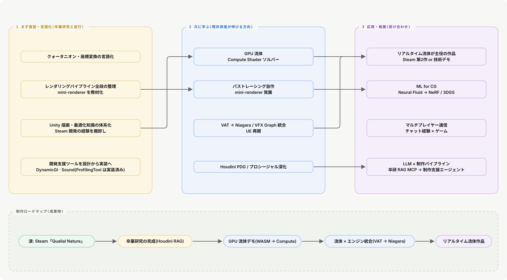

# 松浦真聖 学習・制作ロードマップ

> 作成日: 2026-07-03 / 更新: 2026-11-07
> [STUスキルセット学習ロードマップ](https://www.stu-inc.com/uploads/stu_roadmap_5374985edc.png) のスタイル(カテゴリ別スキルツリー+バッジ)を踏襲。**中身は自分の実績のみ**から構成。

**凡例**: 🟢 習得済み(実績・成果物あり) ｜ 🟡 復習(経験はあるが体系化・言語化が必要) ｜ 🔵 今後学ぶ(自分の路線の延長) ｜ 🟣 応用・発展(既存スキルの掛け合わせ)

## 今後の道筋

## カテゴリ別の一覧

| # | カテゴリ | 🟢 | 🟡 | 🔵 | 🟣 |
|---|---|---:|---:|---:|---:|
| 1 | 基本 / 開発環境 | 10 | 1 | 1 | 1 |
| 2 | プログラミング言語 | 15 | 3 | 3 | 1 |
| 3 | ハードウェア基礎 | 6 | 2 | 2 | 2 |
| 4 | ゲーム制作 | 14 | 1 | 1 | 3 |
| 5 | CG数学・物理・レンダリング | 9 | 2 | 2 | 1 |
| 6 | シミュレーション・流体(最大の独自領域) | 8 | – | 2 | 3 |
| 7 | DCCツール・アート | 6 | 1 | 2 | 2 |
| 8 | AI・LLM・研究基盤 | 8 | – | 1 | 2 |
| 9 | ネットワーク・Web | 8 | 1 | 1 | 1 |
| 10 | 企画・チーム制作 | 12 | 1 | – | 1 |
| 11 | 開発支援ツール・パイプライン基盤 | 8 | – | 2 | 1 |
| | **合計** | **104** | **12** | **17** | **18** |

## 各カテゴリの中身
各項目は開閉できます。🟢 は実績のある項目、🟡🔵🟣 は次の一手です。

### 1. 基本 / 開発環境

🟢 10 ・ 🟡 1 ・ 🔵 1 ・ 🟣 1　高校(2020-2023)で基礎ツール操作を習得 → 大学〜現在まで継続的に更新

**🟢 習得済み**

- Windows 11 — PowerShell
- WSL2 + systemd — 卒研で構築
- Docker — pgvector運用
- Visual Studio — 高校WPF〜Siv3D
- VSCode / Rider系
- Git / GitHub
- GitHub Actions — FluidKit CI
- uv Python
- NuGet / UPM
- Claude Code / MCP — Blender MCP連携

**🟡 復習**

- ブランチ戦略 — チーム開発向け運用

**🔵 今後学ぶ**

- Perforce等 — 大規模開発の構成管理

**🟣 応用・発展**

- CI/CDパイプライン設計 — ビルド・テスト自動化

### 2. プログラミング言語

🟢 15 ・ 🟡 3 ・ 🔵 3 ・ 🟣 1　高校C#(2020-2023) → 大学1〜4年でC/C++/Python/JS/Rust/シェーダーへ拡大(2023-2026)

**🟢 習得済み**

- WinForms / WPF — 高校: チャット・OCR
- Unity C# — Steamリリース
- UdonSharp — VRChat
- C言語基礎 — フレームバッファ・行列
- ゲームアルゴリズム — DotEat・3DCG
- Siv3D — 3D数学課題群
- WASM SPH — 外部依存ゼロC++
- numpy完全ベクトル化 — 流体ソルバー
- PyTorch — GNN訓練 AMP
- RAG / API開発
- HTML/CSS/JS — 高校web課題集
- Three.js — 流体ビューア
- TypeScript — Next.jsアプリ複数
- Rust基礎 — Axum APIバックエンド Lore
- HLSL / ShaderLab — HDRPブラックホール等

**🟡 復習**

- 非同期 / UniTask / ZString — パフォーマンス設計の体系化
- 型設計・状態管理の体系化 — 汎用パターンの言語化
- Compute Shader — GPGPUの体系化

**🔵 今後学ぶ**

- モダンC++体系化 — C++17/20・最適化
- 型注釈・テスト習慣化 — pytest
- 所有権・並行処理の体系化 — 実務レベルの言語化

**🟣 応用・発展**

- WGSL / WebGPU — mini-renderer-gpuの発展

### 3. ハードウェア基礎

🟢 6 ・ 🟡 2 ・ 🔵 2 ・ 🟣 2　高校 工業実習・情報技術実習(2021-2023) → 大学1年 電子情報工学概論(2023) → 大学3年 ゲームハード概論(2025)

**🟢 習得済み**

- Raspberry Pi GPIO制御 — 高校 工業実習
- Raspbian環境構築 — 高校 情報技術実習
- 電子情報工学概論 — 大学1年前期 全14回
- ハードウェア史 — コンピュータ基礎〜歴代機
- 映像/音源出力の仕組み — 特殊映像出力・デジタル音源
- プラットフォーム知識 — 入出力装置・アカウント・規約

**🟡 復習**

- Linuxコマンド運用の再確認 — WSL2運用と接続して体系化
- 論理回路・CPU基礎の再整理 — 低レイヤー理解の土台

**🔵 今後学ぶ**

- 組込み制御の再開 — Arduino/RaspberryPiでの実機制御
- コンピュータアーキテクチャ — 低レイヤー最適化の理論的裏付け

**🟣 応用・発展**

- エッジAI — Raspberry Pi上でのGNN/ML推論
- 実機ターゲット最適化 — コンソール/モバイル知識を活かした軽量化

### 4. ゲーム制作

🟢 14 ・ 🟡 1 ・ 🔵 1 ・ 🟣 3　大学1〜4年の授業(2023-2026)、個人開発・Steamリリースは2024年〜並行

**🟢 習得済み**

- Built-in RP — VRChat案件
- URP / HDRP — ブラックホール表現
- Steamリリース — Qualial Nature
- VAT — AdvancedVAT
- UE基礎 — CGWORLD GALLERY応募作
- GP1: Tennis / Race / Effect
- ShootingGame — +Vosk音声認識
- Siv3D 3Dゲーム基盤
- ゲームAI I — 基礎理論・意思決定
- ゲームAI II — 経路探索・アクションAI・機械学習
- PracticeGameAI 実装演習
- VLM自動プレイエージェント — VLMAutoReplayTool
- ゲームジャム — SGJ2025 / AIGameJam
- チーム制作実習

**🟡 復習**

- SRP拡張 / RenderFeature — 描画パイプライン自作

**🔵 今後学ぶ**

- Niagara / Material — 流体アセットの持ち込み先

**🟣 応用・発展**

- LLM駆動NPC / 生成AIゲーム — AIGameJamの発展
- ゲームAI×流体シミュレーション — 学習型ソルバー知見の転用
- Steam第2作 — 流体/GPU技術を主役に

### 5. CG数学・物理・レンダリング

🟢 9 ・ 🟡 2 ・ 🔵 2 ・ 🟣 1　大学1年 基礎数学(2023) → 大学3年 ゲームプログラミング2で集中的に実装(2025)

**🟢 習得済み**

- 行列 / ベクトル — 2D行列演算〜localSpace
- 補間 — Interpolation課題
- スケルタル / スキニング — Siv3D FBX
- IK — Ortho_bone / IK_Skin
- モーションブレンド
- OBB / カプセル衝突
- 剛体 RigidRect
- パーティクル / ビルボード
- mini-renderer — CPU / GPU

**🟡 復習**

- クォータニオン — 使えるが言語化が課題
- レンダリング理論の体系化 — パイプライン全段を説明できるレベル

**🔵 今後学ぶ**

- パストレーシング / GI — PBRT系の自作実装
- DirectX12 / Vulkan — 生APIでの理解

**🟣 応用・発展**

- ニューラルレンダリング — NeRF / 3DGS ← GNN経験と接続

### 6. シミュレーション・流体(最大の独自領域)

🟢 8 ・ 🟡 0 ・ 🔵 2 ・ 🟣 3　個人R&D 2024年〜現在(大学の授業外で継続開発)

**🟢 習得済み**

- SPH — 空間ハッシュ近傍探索
- FLIP ハイブリッド
- Stable Fluids 格子法
- 再現性保証 — SHA-256状態ハッシュ
- WASM SPH — ブラウザ実行
- GNN v1-v3 — 1.13Mパラメータ 訓練済
- Blender連携 — NPZ / MCP
- Houdini HDA

**🔵 今後学ぶ**

- GPU流体 — Compute Shaderソルバー
- エンジン統合 — VAT → Niagara / VFX Graph

**🟣 応用・発展**

- 学習型ソルバーの実用化 — 推論高速化・蒸留
- MPM / 煙・炎など他分野 — ソルバー横展開
- Steam第2作 / デモ作品 — リアルタイム流体を売りに

### 7. DCCツール・アート

🟢 6 ・ 🟡 1 ・ 🔵 2 ・ 🟣 2　高校 デジタル造形(C4D, 2023) → 個人制作で継続中(2023〜現在)

**🟢 習得済み**

- Blender — MCP自動化・流体ビューア
- Houdini — HDA・卒研RAG対象
- Cinema 4D — デジタル造形課題
- Clip Studio — イラスト多数
- Aseprite — ドット絵
- ゲーム素材制作 — ひび割れ・血痕等

**🟡 復習**

- Houdiniエフェクト制作

**🔵 今後学ぶ**

- PDG / プロシージャル深化 — パイプライン自動化
- ジオメトリノード

**🟣 応用・発展**

- DCC間データ交換の設計 — FBX / USD / Alembic
- LLM×DCC自動化 — 卒研RAG MCPの発展形

### 8. AI・LLM・研究基盤

🟢 8 ・ 🟡 0 ・ 🔵 1 ・ 🟣 2　個人R&D 2024年〜、大学4年 卒業研究として集大成(2025-2026)

**🟢 習得済み**

- mcp-rag-server — ローカルRAG自作
- 卒研: Houdini Help RAG — pgvector 7810ファイル
- Research-Collector — NotebookLM連携
- GNN設計・訓練 — AMP / CosineAnnealing
- 3D生成推論 — TripoSR CAD→3D
- 音声認識組込み — Vosk
- MCPサーバー開発
- Gemini Live API検証

**🔵 今後学ぶ**

- 評価・検索精度改善 — 卒研の完成度向上

**🟣 応用・発展**

- 制作支援エージェント — DCC操作×RAG×MCPの統合
- ML for CG — Neural Fluid → NeRF/3DGS

### 9. ネットワーク・Web

🟢 8 ・ 🟡 1 ・ 🔵 1 ・ 🟣 1　高校 チャットアプリ実習(2022-2023) → 個人API開発で継続(2024〜) → Next.js/Rustアプリへ拡大(2026)

**🟢 習得済み**

- TCPソケット通信 — 高校チャットアプリ
- SQLite
- PostgreSQL + pgvector
- EntityFramework — 高校課題研究
- 静的サイト — web課題集〜miyagisite
- モダンフロントエンド — Next.js/TypeScript 複数アプリ
- デスクトップGUI — Qt6/QML
- Next.js / Vercel のサイト — miyagisite・図鑑 3 種・天気ダッシュボード

**🟡 復習**

- 通信の体系知識 — プロトコル・暗号化の整理

**🔵 今後学ぶ**

- 状態管理・テスト — フロントエンド設計の体系化

**🟣 応用・発展**

- マルチプレイヤーゲーム通信 — チャット経験×ゲーム制作

### 10. 企画・チーム制作

🟢 12 ・ 🟡 1 ・ 🔵 0 ・ 🟣 1　大学1〜3年の授業・実習(2023-2025)

**🟢 習得済み**

- ゲーム構成論 — メカニクス・バランス・世界観
- 企画発想法 — マンダラ・チェックリスト法
- コンテンツデザイン概論
- エンタテインメント設計
- インターフェースデザイン — UI/UX理論
- ゲーム制作技術総合実習
- 地域共創デザイン実習
- ゲームジャム複数回
- 週報 / プロジェクト運営 — 3年制作応用実習
- コンテンツ制作マネジメント — 2年前期
- チームワークとリーダーシップ — 2年後期
- 知的財産権 / 企業経営 — グローバル市場化戦略

**🟡 復習**

- 進行管理の言語化 — チーム開発経験の棚卸し

**🟣 応用・発展**

- 技術主導の企画 — R&D成果を企画に変換する型

### 11. 開発支援ツール・パイプライン基盤

🟢 8 ・ 🟡 0 ・ 🔵 2 ・ 🟣 1　個人R&D 2026年8月〜(CEDEC講演に触発され集中的に着手)

**🟢 習得済み**

- VisualRegressionQATool — スクリーンショット差分・DB永続化
- AssetDataInsightSuite — アセット品質の取込〜可視化パイプライン
- ToolOrchestrationHub — ツール群のRegistry/死活監視/ダッシュボード
- ProfilingTool — ToolOrchestrationHub のサブ機能として統合
- CI連携 — GitHub Actions で画面差分を自動チェック(VisualRegressionQATool)
- FlowchartVisualizerExtension — VSCode / Visual Studio / Rider の制御フロー可視化
- DocsPipeline — docstring から API 文書を自動生成して公開
- ProductionTracker — 制作進行ボード(Django + React)

**🔵 今後学ぶ**

- 監視対象ツールの実運用投入
- DynamicGIMiddleware / SoundMiddleware — 設計から実装へ

**🟣 応用・発展**

- 制作パイプライン全体の内製化 — TA/ツールエンジニアとしての核

## まとめ

- **一貫した軸**: 「動くものを作りながら低レイヤーへ潜る」— 高校: 組込み(Raspberry Pi)/アプリ(C#) → 大学: ゲームフルスクラッチ → 3D数学・ハードウェア理論 → 自作ソルバー/レンダラー → ML
- **他人と被らない資産**: ①自作流体エンジン一式(SPH/FLIP/GNN/WASM) ②LLM/RAG/MCP基盤 ③Steamリリース実績 ④高校由来の組込み/ハードウェア知識 ⑤内製開発支援ツール群(QA自動化・アセット可視化・ツール監視基盤)。今後はこれらの**掛け合わせ**が最も費用対効果が高い
- **弱点は「新技術」ではなく「言語化」**: 実装済みのものを説明できる形に整理することが、当面の最優先タスク
